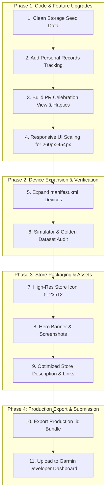

# The Amazing Pull Up — Connect IQ Store Launch Plan

This roadmap outlines the complete path from local development to publishing **"The Amazing Pull Up - Workout & Reps"** on the Garmin Connect IQ Store.

---

## 1. Executive Summary & Core Decisions

| Decision Area | Agreed Choice | Rationale |
| :--- | :--- | :--- |
| **Monetization** | **Free + "Buy Me a Coffee" / PayPal link** | \$0 upfront/annual fees, avoids 15–20% cuts, eliminates licensing bugs, and maximizes user adoption and 5-star reviews. |
| **Store Title** | **The Amazing Pull Up - Workout & Reps** | Balances unique brand identity with high-ranking search keywords for "Pull Up", "Workout", and "Reps". |
| **Launcher Name** | **Pull Ups** | Keeps the watch launcher menu concise and clean on round screens. |
| **V1.0 Scope** | **Personal Records (PRs) + Celebration + Responsive UI** | High-dopamine features with zero background battery risk. Scheduled reminders deferred to V1.1. |
| **Device Support** | **Modern Round CIQ 5+ Watches** | Covers FR165, FR255, FR265, FR955, FR965, FR70, FR170, FR570, FR970, Fenix 7/8, Epix 2, Venu 2/3, Vivoactive 5. (FR55/245 excluded due to 128 KB memory limits). |
| **Visual Identity** | **Neon Green & Gold Athletic Silhouette** | Sleek dark aesthetic matching Garmin's sports interface. |

---

## 2. Release Roadmap & Phases



---

## 3. Phase 1: Code & Feature Implementation

### 3.1 Storage Test Data Cleanup
- **Target File**: [`source/PullUpStorage.mc`](file:///c:/Users/TLP-001/Documents/Garmin/PullUp/source/PullUpStorage.mc#L55-L68)
- **Problem**: Currently, `seedTestData()` injects 110 reps today and 470 reps this week on fresh installations for testing.
- **Action**: Replace `seedTestData()` with zero-initialized defaults so real users start with clean 0-rep slates. Keep a debug/simulator-only toggle if needed.

### 3.2 Personal Records (PR) Engine
- Store 3 all-time records in `PullUpStorage`:
  1. `KEY_PR_SET_REPS`: All-time single-set maximum reps.
  2. `KEY_PR_DAY_REPS`: All-time single-day total reps.
  3. `KEY_PR_WEEK_REPS`: All-time single-week total reps.
- Comparison logic runs immediately upon set/workout confirmation in [`PullUpEditDelegate.mc`](file:///c:/Users/TLP-001/Documents/Garmin/PullUp/source/PullUpEditDelegate.mc) and [`PullUpFinishDelegate.mc`](file:///c:/Users/TLP-001/Documents/Garmin/PullUp/source/PullUpFinishDelegate.mc).

### 3.3 Dedicated Celebration View (`PullUpCelebrationView`)
- Triggered when saving any set or workout that establishes a new PR.
- **Visuals**:
  - Gold/Yellow accent theme (`Graphics.COLOR_YELLOW` / Gold `#FFD700`).
  - Trophy icon / celebratory banner (`NEW RECORD! 🏆`).
  - Specific achievement callout (e.g. `18 Reps - Best Set!` or `65 Reps - Best Day!`).
- **Haptics**: Distinctive celebratory vibration pulse (`Attention.vibrate([new Attention.VibeProfile(100, 200), new Attention.VibeProfile(0, 100), new Attention.VibeProfile(100, 300)])`).
- **Dismissal**: Auto-dismisses after 3 seconds or on key press/tap, returning seamlessly to the main menu.
- **Badges on History**: Display small gold star/trophy indicators next to PR stats on [`PullUpHistoryView.mc`](file:///c:/Users/TLP-001/Documents/Garmin/PullUp/source/PullUpHistoryView.mc).

### 3.4 Responsive Layout Engine (Multi-Resolution)
- **Current Issue**: Views currently use fixed pixel coordinates calibrated for 390x390 (`fr165m`).
- **Action**: Convert absolute Y coordinates to proportional heights:
  - Header: `y = (h * 0.12).toNumber()`
  - Primary Rep Counter: `y = (h * 0.28).toNumber()`
  - Metric Subtitles / Time: `y = (h * 0.65).toNumber()`
  - Dynamic font selection based on `h < 300` (MIP watches) vs `h >= 390` (AMOLED watches).

---

## 4. Phase 2: Device Compatibility Expansion

### 4.1 Device Support Matrix in `manifest.xml`

> [!NOTE]
> Older budget watches like **Forerunner 55** and **Forerunner 245** have strict **128 KB memory limits** for Watch Apps. The compiled `PullUp.prg` is ~170 KB due to 100 Hz sensor buffers and multi-screen state machines, causing an immediate Out-Of-Memory error on those legacy devices. Modern watches have 1 MB+ RAM and run smoothly.

| Category | Screen Specs | Target Devices |
| :--- | :--- | :--- |
| **Forerunner AMOLED** | 360x360 – 454x454 | `fr165`, `fr165m`, `fr265`, `fr265s`, `fr965`, `fr70`, `fr170`, `fr170m`, `fr57042mm`, `fr57047mm`, `fr970` |
| **Forerunner MIP** | 218x218 – 260x260 | `fr255`, `fr255m`, `fr255s`, `fr255sm`, `fr955` |
| **Fenix / Epix** | 240x240 – 454x454 | `fenix7`, `fenix7s`, `fenix7x`, `fenix7pro`, `fenix843mm`, `fenix847mm`, `fenix8solar47mm`, `epix2`, `epix2pro42mm`, `epix2pro47mm`, `epix2pro51mm` |
| **Venu & Vivoactive** | 360x360 – 454x454 | `venu2`, `venu2s`, `venu2plus`, `venu3`, `venu3s`, `vivoactive5` |

### 4.2 Automated Verification
- Verify build and simulation across three reference resolutions:
  1. Small MIP (260x260): `fr255`
  2. Baseline AMOLED (390x390): `fr165m`
  3. Large AMOLED (454x454): `fr965`

---

## 5. Phase 3: Store Listing & Marketing Package

### 5.1 Store Metadata
- **Store Title**: `The Amazing Pull Up - Workout & Reps`
- **Short Tagline**: `Automatic 100 Hz pull-up repetition counter, rest timer, and workout tracker with Garmin Connect sync.`
- **Category**: Fitness & Gym / Sports
- **Pricing**: Free

### 5.2 Store Description Draft
```markdown
🔥 Take your pull-up training to the next level with The Amazing Pull Up!

Tired of manually tapping your watch or losing count mid-set? The Amazing Pull Up uses high-frequency 100 Hz accelerometer motion processing to automatically detect, count, and analyze your pull-up reps live on your wrist.

KEY FEATURES:
• 🎯 Automatic Rep Detection: High-precision 100 Hz algorithm detects chin-over-bar reps and ignores setup/mounting shakes.
• ⚡ Single Quick Set Mode: Hop on the bar, get your reps counted, and record your set in seconds.
• ⏱️ Multi-Set Workouts: Structured multi-set training with customizable rest timers between sets.
• 🏆 Personal Records (PRs): Tracks your all-time best set, best day, and best week with celebratory badges.
• 📊 7-Day Volume Glance: Native step-style volume history to track your weekly training load.
• 💾 Garmin Connect Sync: Saves full Strength Training activities with developer rep metrics directly to Garmin Connect.

COMPLETELY FREE & INDEPENDENT:
This app is 100% free with no annoying paywalls or ads. If you love using it and want to support ongoing development:
☕ Buy Me a Coffee: https://buymeacoffee.com/YOUR_HANDLE
(or PayPal: https://paypal.me/YOUR_HANDLE)

Got feedback or ideas? Leave a review or reach out through Contact Developer!
```

### 5.3 Visual Assets Needed
1. **App Icon (512x512 PNG)**: Neon green and gold athletic silhouette on a dark textured background.
2. **Cover / Feature Graphic (1024x500 PNG)**: Watch face showcase with app branding and tagline.
3. **Store Screenshots (Round Watch Mockups)**:
   - Screenshot 1: Live rep counter in action (Green big digits).
   - Screenshot 2: Multi-set workout with Rest Timer.
   - Screenshot 3: New Record celebration screen (`NEW RECORD! 🏆`).
   - Screenshot 4: 7-Day volume bar chart with PR highlights.

---

## 6. Phase 4: Production Export & Submission Checklist

1. [ ] **Developer Key**: Verify `developer_key` is backed up safely (needed for all future app updates).
2. [ ] **Jungle & Manifest**: Ensure all target products are configured in `manifest.xml`.
3. [ ] **Clean Production Build**:
   ```powershell
   & "$env:APPDATA\Garmin\ConnectIQ\Sdks\connectiq-sdk-win-9.2.0-2026-06-09-92a1605b2\bin\monkeyc.bat" `
       -e -f monkey.jungle -o bin/TheAmazingPullUp.iq -y developer_key
   ```
4. [ ] **Connect IQ Developer Dashboard**:
   - Navigate to [Garmin Developer Dashboard](https://apps.garmin.com/developer/dashboard).
   - Click **Upload an App**.
   - Upload `bin/TheAmazingPullUp.iq`.
   - Fill in Title, Description, Support Email, and donation links.
   - Upload 512x512 icon, cover banner, and screenshots.
   - Submit for approval (Garmin review typically takes 1–3 business days).
